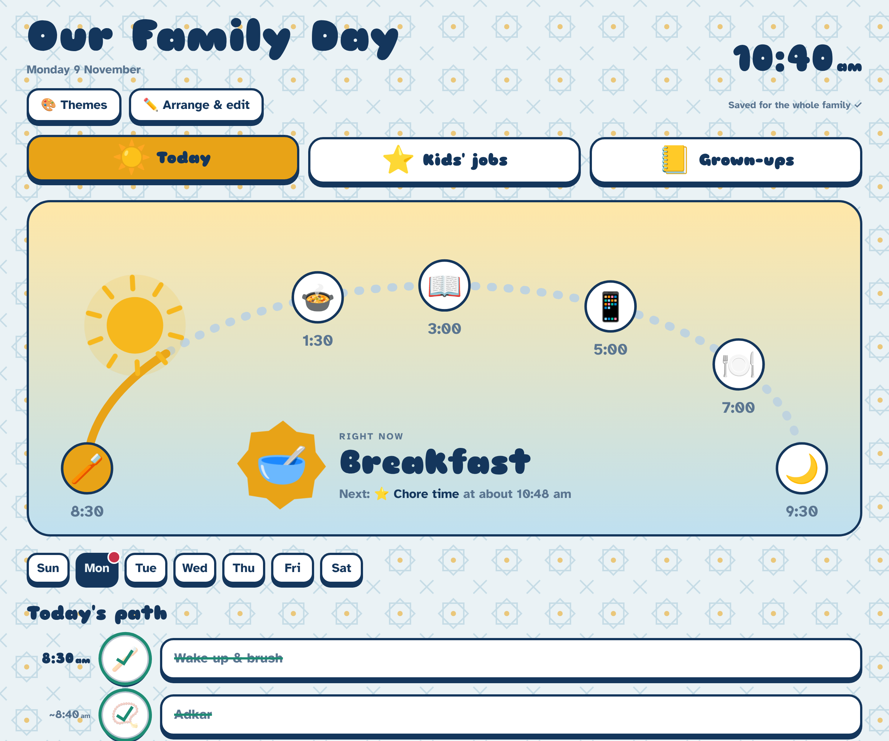
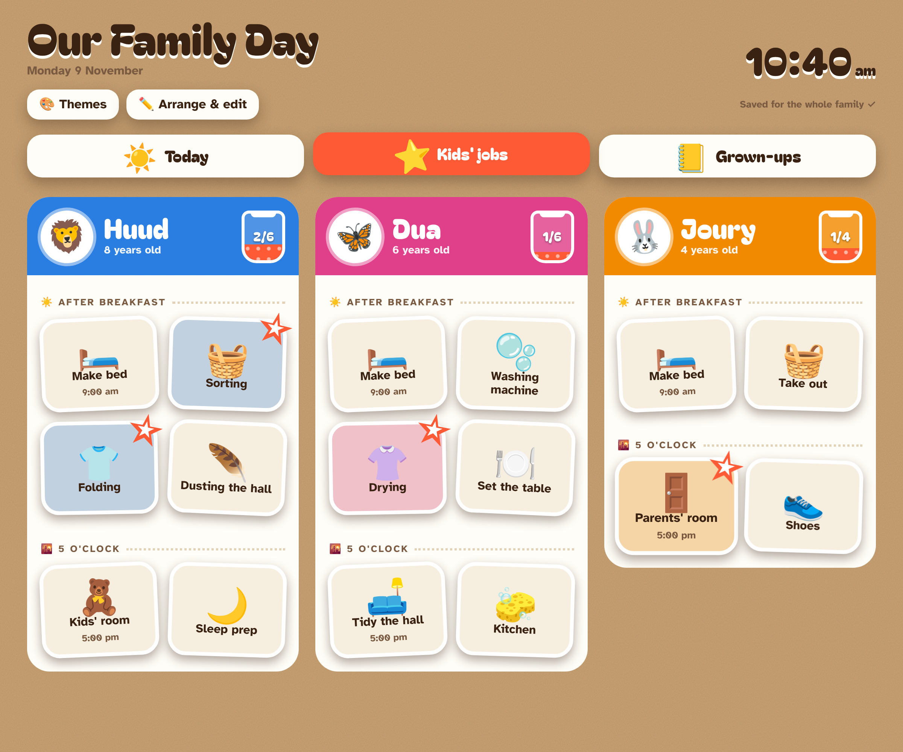
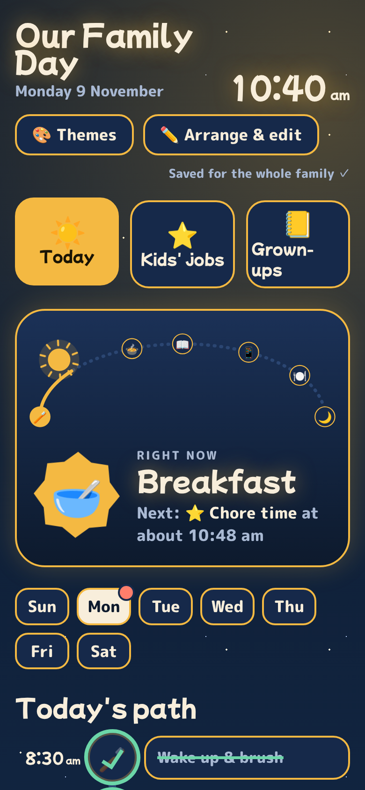

# Our Family Day

A picture-based routine board for the family. It's built so the kids (ages 4 to 8) can follow it from the pictures alone, while the grown-ups keep their own lists alongside.



| Kids' jobs (Sticker book theme) | On a phone (Lantern night theme) |
| --- | --- |
|  |  |

## What's in it

- **Today**: the sun moves along a sky arc through the day's timed steps, and a big "Right now" card shows the current step with what comes next. The full plan runs underneath as a path, and each step gets a ✓ stamp when you tap it. Pick another weekday to see that day's plan. Bath only shows on Mon, Thu, Fri and Sat, and Dheen on Tue, Wed and Fri.
- **Kids' jobs**: a sticker sheet for Huud, Dua and Joury. Jobs are split into "After breakfast" and "5 o'clock". Tapping a job puts a star on it and fills the child's star jar, and finishing every job brings up a cheer.
- **Grown-ups**: a notebook page with tick boxes for Mum and Dad.
- **Arrange & edit**: drag ⠿ to reorder anything, including moving a job to another child or to the other time slot. You can change names, pictures (any emoji or letter) and times, limit a step to certain weekdays, and add or remove items. Steps with no time get spaced evenly between the timed ones (shown with a "~").
- **Themes**: Zellige, Sticker book, Lantern night, Chalkboard and Riso print. The theme you pick is saved for the whole family.

Ticks and stars reset each day. Every phone and tablet shares one copy of the routine, and they pick up each other's changes within about 15 seconds.

## How it's built

| Path | What it is |
| --- | --- |
| `public/index.html` | The whole app in one file (HTML, CSS and JS). Fonts come from Google Fonts and drag-and-drop from SortableJS on cdnjs. |
| `src/worker.js` | A small Cloudflare Worker API that saves the routine and each day's ticks to Workers KV |
| `wrangler.toml` | Cloudflare config: the Worker, the `public/` folder as static files, and the KV binding |
| `docs/` | Screenshots for this README |

There's no build step. You edit `public/index.html` and deploy.

## Deploy on Cloudflare (from GitHub, no installs)

1. **Create the storage.** In the Cloudflare dashboard, go to **Storage & Databases → KV → Create**, name it `routine`, and copy its **ID**.
2. **Paste the ID.** On GitHub, open `wrangler.toml`, click the pencil, replace `PASTE_YOUR_KV_ID_HERE` with the ID, and commit to `main`.
3. **Connect the repo.** Go to **Workers & Pages → Create → Import a repository**, choose `routine`, and keep the default deploy command (`npx wrangler deploy`). Press **Deploy**.
4. **Add a PIN (optional, recommended).** In the Worker, go to **Settings → Variables and Secrets → Add**, choose type **Secret**, name it `FAMILY_PIN` and enter any number. Each device then asks for the PIN once.
5. **Open it** at `https://family-day.<your-subdomain>.workers.dev`. On the kids' tablet, use **Add to Home Screen** so it opens full screen like an app.

From then on, every push to `main` goes live automatically, and the saved routine and stars are kept.

## Deploy from your computer instead

```
npm install
npx wrangler login
npx wrangler kv namespace create ROUTINE   # paste the printed id into wrangler.toml
npx wrangler deploy
npx wrangler secret put FAMILY_PIN         # optional
```

Run it locally with `npx wrangler dev`.

## Changing the starting routine

The routine people edit in the app lives in KV, so changes made in **Arrange & edit** never need a code change. The built-in starting routine is used only before the first save. It's the `DEFAULT_PLAN` block near the top of the script in `public/index.html`, so edit it there if you want a different starting point on a fresh setup.

## API

| Method | Path | Does |
| --- | --- | --- |
| GET | `/api/plan` | Returns the saved routine, or `null` before the first save |
| PUT | `/api/plan` | Saves `{ plan }` |
| GET | `/api/ticks/YYYY-MM-DD` | Returns `{ done: { id: true } }` for that day |
| POST | `/api/ticks/YYYY-MM-DD` | Ticks or unticks one item: `{ id, on }` |
| PUT | `/api/ticks/YYYY-MM-DD` | Clears that day's ticks |

When `FAMILY_PIN` is set, every request must send the header `x-family-pin`. A day's ticks are deleted automatically after 30 days.
